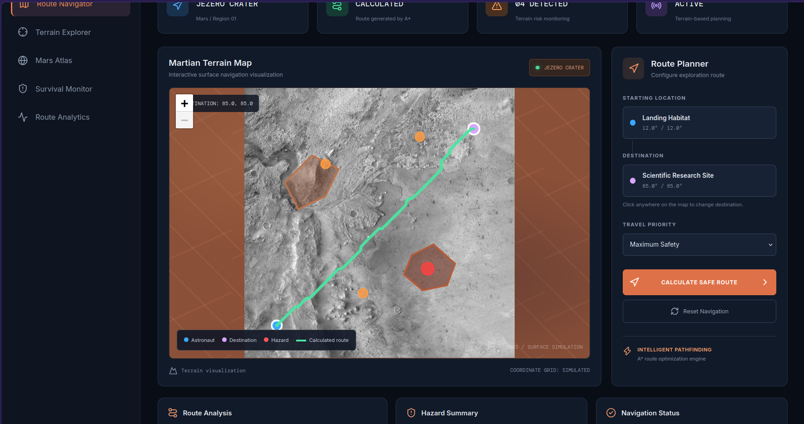
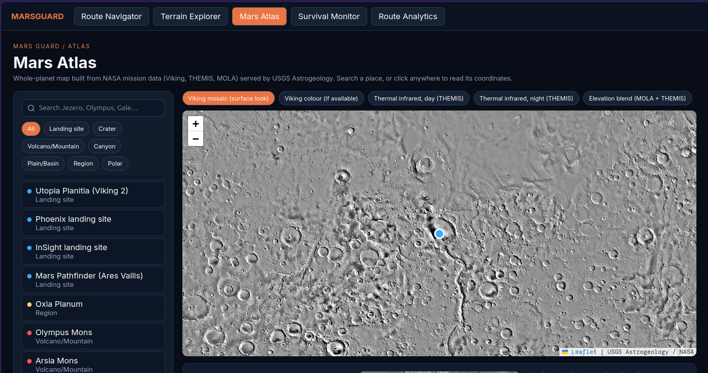
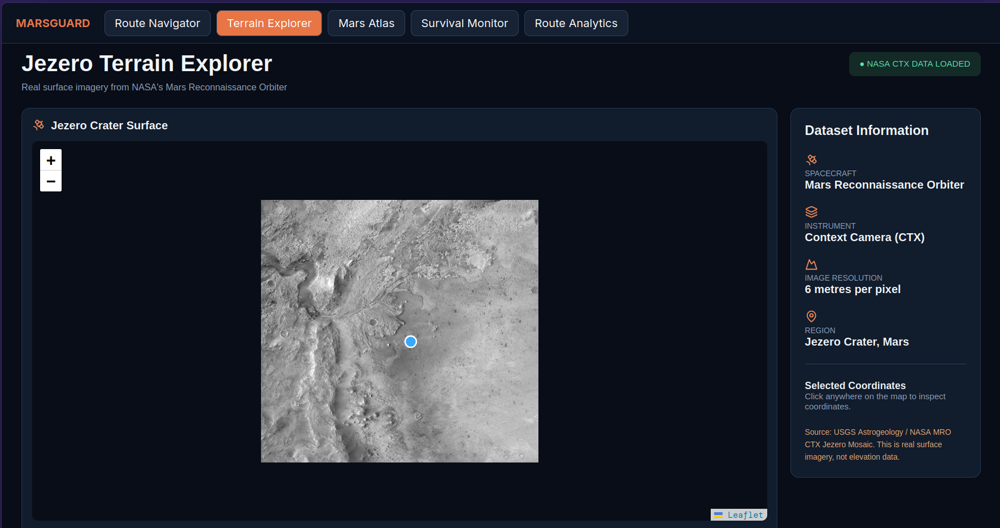
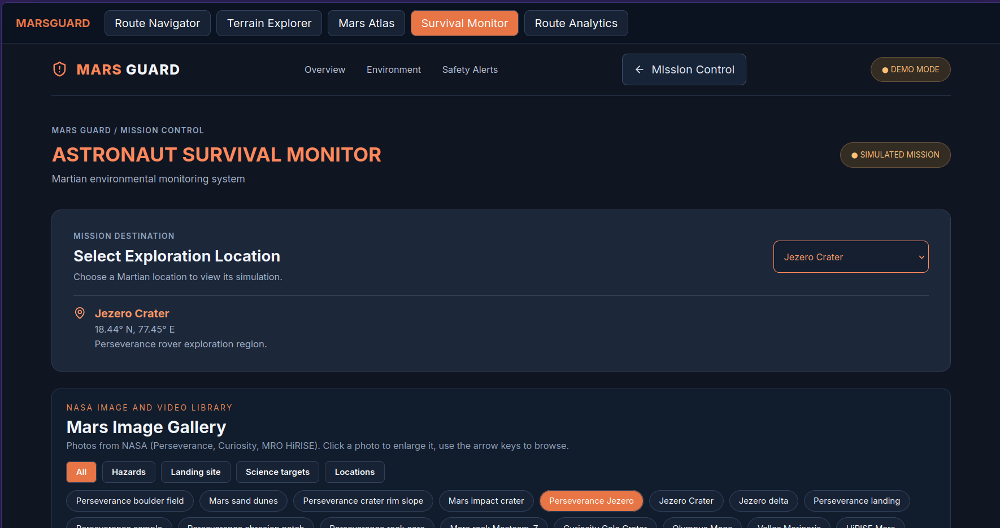

# MARS GUARD: Interplanetary Survival Guide (Martian Map)

A web-based crew map that helps astronauts decide where they can travel on Mars and whether conditions are safe. Built by **Team XELESTRA** for the NASA Space Apps Challenge 2026.

**Live website:** https://arppitha-ai.github.io/mars-guard/
**Presentation (7 slides):** [MARS_GUARD_XELESTRA_7_slides-1.pdf](MARS_GUARD_XELESTRA_7_slides-1.pdf)

## Screenshots

| Route Navigator | Mars Atlas |
|---|---|
|  |  |
| **Terrain Explorer** | **Survival Monitor** |
|  |  |

## What it does

Mars Guard has five tools:

- **Route Navigator**: pick a destination in Jezero Crater and a priority (maximum safety, balanced or shortest). An A* search finds a walking route that avoids rock fields, craters and steep slopes, then reports distance, walking time and risk level.
- **Terrain Explorer**: detailed Jezero Crater imagery with a gallery of NASA photos (Perseverance, Curiosity, HiRISE), filtered by hazards, landing sites and science targets.
- **Mars Atlas**: a whole-planet map with four layers (Viking surface imagery, THEMIS thermal infrared for day and night, and MOLA elevation) and 33 searchable places.
- **Survival Monitor**: temperature, radiation, pressure, oxygen and wind readings, 24-hour trend charts and a safety decision (safe, caution or danger).
- **Route Analytics**: distance, estimated travel time and risk level of the chosen route.

To show the crew what to expect, a **hazard field guide** and a **destination preview** display real NASA photos of each hazard type and of the terrain at the destination.

## Data layers

| Layer | What it shows | Source |
|---|---|---|
| Optical | Surface imagery of Mars and Jezero Crater | NASA Viking mosaic and Mars 2020 CTX imagery, via USGS Astrogeology |
| Thermal | Day and night infrared temperature patterns | NASA THEMIS, via USGS Astrogeology |
| Topographic | Elevation relief | NASA MOLA, via USGS Astrogeology |
| Radiation | Dose rate and solar particle event | Simulated for demonstration |
| Atmospheric | Temperature, pressure, wind, oxygen | Simulated per location |

## Data and resources

- NASA Image and Video Library: https://images.nasa.gov
- USGS Astrogeology Mars web map service (NASA Viking, THEMIS and MOLA data): https://planetarymaps.usgs.gov/cgi-bin/mapserv?map=/maps/mars/mars_simp_cyl.map
- Mars 2020 Jezero Crater CTX orthorectified imagery (NASA, via USGS Astrogeology): https://astrogeology.usgs.gov

## Built with

React, Vite, JavaScript, HTML and CSS, Leaflet and React Leaflet (maps), Recharts (charts), Lucide Icons, an A* pathfinding algorithm that runs in the browser, GitHub Actions and GitHub Pages. An earlier Python/Flask version of the route search is included in the `backend` folder.

## Run it on your computer

You need Node.js installed.

```bash
cd frontend
npm install
npm run dev
```

Then open the address shown in the terminal (usually http://localhost:5173/mars-guard/).

## Limitations

- The hazard positions, the route grid, and the radiation and atmosphere readings are **simulated** for demonstration.
- The surface, thermal and elevation layers and the photos are real NASA data, but the system does not use live rover sensor data.
- Place coordinates in the Atlas are approximate.

## Future work

- Hazard maps built from real elevation and HiRISE data
- The full list of official Mars place names (USGS Gazetteer)
- Real radiation and space weather data
- Suit-aware safety decisions (oxygen, battery, time outside)
- Route planning anywhere on Mars and a helmet HUD view

## Use of Super Intelligence (SI) tools

AI assistants were used in this project. ChatGPT helped generate the first version of the website code, and Claude helped debug, extend and document it and prepare the presentation.

- **Code:** the website and route-finding code were written with AI assistance and reviewed by the team.
- **Data:** the hazard positions, route grid, radiation and atmosphere readings and the list of 33 places are simulated or approximate and were created with AI assistance.
- **Text:** the project description and presentation were drafted with AI assistance.

All Mars imagery and photos come from NASA and USGS sources and are not AI-generated. No NASA logos or branding were created or modified.

## Team XELESTRA

ARPPITHA R A, MANHA T J, ASWAL A S
